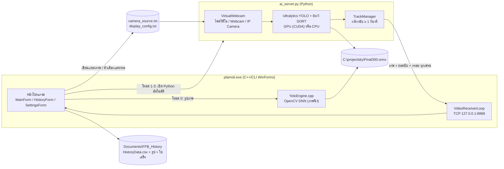

# 🌴 Smart Palm App — ระบบคัดเกรดและคำนวณราคาทะลายปาล์มด้วย AI

โปรแกรม Windows สำหรับ **ลานรับซื้อปาล์มน้ำมัน** ใช้ AI (YOLOv8 แบบ segmentation) ตรวจจับทะลายปาล์มจากภาพ วิดีโอ หรือกล้อง แล้วแยกระดับความสุก 6 ระดับ นับจำนวนแต่ละระดับ คำนวณราคารับซื้อหลังหักคุณภาพ ออกใบเสร็จ และเก็บประวัติการซื้อขาย

| | |
|---|---|
| **หน้าโปรแกรม** | C++/CLI Windows Forms (.NET Framework 4.7.2) |
| **AI** | YOLOv8n-seg (`Final300.onnx`) รันได้ 2 ทาง: OpenCV DNN ใน C++ (ภาพนิ่ง) และ Ultralytics ใน Python (วิดีโอ/กล้อง) |
| **การติดตามวัตถุ** | BoT-SORT + กติกานับ "อยู่ในจอต่อเนื่อง ≥ 1 วินาที" |
| **ความเร็ว (RTX 4050 Laptop)** | กล้อง Webcam ~29 FPS, ไฟล์วิดีโอ ~18 FPS, ภาพนิ่ง ~0.3 วินาที/ภาพ (ถ้าไม่มีการ์ดจอ: ~7–10 FPS) |

---

## สารบัญ

1. [ความสามารถของโปรแกรม](#1-ความสามารถของโปรแกรม)
2. [สถาปัตยกรรมระบบ](#2-สถาปัตยกรรมระบบ)
3. [โครงสร้างไฟล์](#3-โครงสร้างไฟล์)
4. [สิ่งที่ต้องมีก่อนติดตั้ง](#4-สิ่งที่ต้องมีก่อนติดตั้ง)
5. [ติดตั้งทีละขั้นตอน](#5-ติดตั้งทีละขั้นตอน)
6. [วิธีใช้งาน](#6-วิธีใช้งาน)
7. [รายละเอียดทางเทคนิค](#7-รายละเอียดทางเทคนิค)
8. [ค่าที่ปรับได้](#8-ค่าที่ปรับได้)
9. [การแก้ปัญหา](#9-การแก้ปัญหา-troubleshooting)
10. [ผลทดสอบและข้อจำกัด](#10-ผลทดสอบและข้อจำกัดที่ควรรู้)
11. [ประวัติการเปลี่ยนแปลง](#11-ประวัติการเปลี่ยนแปลง)
12. [ผู้พัฒนาและแหล่งอ้างอิง](#12-ผู้พัฒนาและแหล่งอ้างอิง)

---

## 1. ความสามารถของโปรแกรม

- **รับภาพได้ 4 แบบ**
  - `0` รูปภาพ (.jpg / .png)
  - `1` ไฟล์วิดีโอ (.mp4 / .avi)
  - `2` กล้อง Webcam ของเครื่อง
  - `3` กล้องมือถือผ่านแอป IP Webcam (เช่น `http://192.168.1.10:8080/video`)
- **ตรวจจับและแยกระดับความสุก 6 คลาส** พร้อมกรอบ (box) และพื้นที่ทะลาย (mask) เปิด/ปิดการแสดงได้
- **นับจำนวนสะสม** ในวิดีโอและกล้องสด ทะลายแต่ละลูกนับครั้งเดียว และล็อกคลาสไม่ให้กระโดดไปมา
- **คำนวณราคา** จากน้ำหนักรถเข้า–ออก ราคาฐาน และอัตราหักตามสัดส่วนทะลายแต่ละเกรด
- **ออกใบเสร็จ** (ภาพ .png) และ **บันทึกประวัติ** ลง CSV พร้อมภาพต้นฉบับและพิกัดกรอบ AI เปิดดูย้อนหลังและวาดกรอบซ้ำได้ในหน้า Dashboard
- **กราฟสัดส่วนความสุก** ในหน้า Data Entry

| คลาส | ชื่อในโมเดล | ภาษาไทย | สีในโปรแกรม | หักราคาเริ่มต้น (บาท/กก.) |
|:-:|---|---|---|:-:|
| 0 | `empty_bunch` | ทะลายเปล่า | LightCoral | 5.80 |
| 1 | `overripe` | สุกเกิน | Orange | 0.50 |
| 2 | `ripe` | สุก | LimeGreen | 0.00 |
| 3 | `rotten` | เน่า | Silver | 5.80 |
| 4 | `underripe` | ห่าม | Gold | 0.20 |
| 5 | `unripe` | ดิบ | DeepSkyBlue | 2.00 |

---

## 2. สถาปัตยกรรมระบบ



**หลักการทำงาน**

- **โหมดรูปภาพ (0)** ฝั่ง C++ ทำงานเองทั้งหมด ไม่ต้องใช้ Python
  - โหลดโมเดลครั้งเดียวแล้วใช้ซ้ำ และเก็บผลตรวจจับของภาพล่าสุดไว้
  - กดเปิด/ปิดกรอบ, มาสก์ หรือกรองคลาส จะวาดใหม่ทันที ไม่รัน AI ซ้ำ
- **โหมดวิดีโอ/กล้อง (1–3)**
  1. กด Start แล้ว C++ เปิด TCP server ที่พอร์ต 8888
  2. C++ สั่งรัน `C:\projectsky\venv\Scripts\python.exe ai_server.py` แบบซ่อนหน้าต่าง
  3. Python โหลดโมเดล อุ่นเครื่อง แล้วต่อเข้ามาที่พอร์ต 8888
  4. Python ส่งผลกลับมาทุกเฟรม
- **ปิดระบบ:** กด Stop, วิดีโอเล่นจบ หรือปิดหน้าต่างโปรแกรม จะปิด Python ให้อัตโนมัติ ไม่มี process ค้าง

---

## 3. โครงสร้างไฟล์

### ใน repository นี้

```
SmartPalmApp/
├── plamoil.sln                  ← เปิดไฟล์นี้ใน Visual Studio
├── ai_server.py                 ← สมอง AI ฝั่ง Python (ต้องก๊อปไปไว้ที่ C:\projectsky)
├── requirements-gpu.txt         ← แพ็กเกจ Python สำหรับเครื่องที่มีการ์ดจอ NVIDIA
├── requirements-cpu.txt         ← แพ็กเกจ Python สำหรับเครื่องที่ไม่มีการ์ดจอ NVIDIA
├── README.md
└── plamoil/
    ├── plamoil.vcxproj          ← ตั้งค่า build (OpenCV path, คัดลอก DLL อัตโนมัติ)
    ├── MainForm.h / .cpp        ← หน้าหลัก: รับภาพ, ท่อรับข้อมูลจาก Python, คำนวณราคา, ใบเสร็จ
    ├── HistoryForm.h / .cpp     ← หน้าประวัติ
    ├── SettingsForm.h           ← หน้าตั้งราคาฐานและอัตราหัก
    ├── YoloEngine.h / .cpp      ← ตัวรันโมเดลด้วย OpenCV DNN (โหมดรูปภาพ)
    ├── ai_server_backup.py      ← ai_server รุ่นเก่า (เก็บไว้อ้างอิง ไม่ได้ใช้งาน)
    └── app.ico, app.rc, *.resx  ← ไอคอนและ resource ของหน้าจอ
```

### ไฟล์ที่ไม่อยู่ใน GitHub แต่ต้องมี

โค้ดอ้างอิงที่อยู่เหล่านี้แบบตายตัว **ต้องวางให้ตรงทุกตัวอักษร**

```
C:\opencv\                       ← OpenCV 4.12.0 (แตกจาก opencv-4.12.0-windows.exe)
└── build\
    ├── include\
    └── x64\vc16\{lib,bin}\      ← opencv_world4120(d).lib / .dll

C:\projectsky\                   ← โฟลเดอร์ทำงานของ AI (ทำเป็น junction ไปไดรฟ์อื่นได้ ดูข้อ 5.4)
├── Final300.onnx                ← ไฟล์โมเดล (ขอจากทีม ไม่อยู่ใน Git เพราะไฟล์ใหญ่)
├── ai_server.py                 ← ก๊อปจาก repo
├── venv\                        ← Python virtual environment
├── camera_source.txt            ← (สร้างอัตโนมัติ) แหล่งภาพที่เลือกล่าสุด
├── display_config.txt           ← (สร้างอัตโนมัติ) เปิด/ปิด box, mask, กรองคลาส
└── ai_server_log.txt            ← (สร้างอัตโนมัติ) log ของ Python รอบล่าสุด

%USERPROFILE%\Documents\FFB_History\   ← (สร้างอัตโนมัติ) ประวัติการซื้อขาย
├── HistoryData.csv
├── Images\                      ← ภาพที่อัปโหลด/เฟรมจากวิดีโอ
├── Slip_<เวลา>.png              ← ใบเสร็จ
├── Image_<เวลา>.png             ← ภาพผลวิเคราะห์
└── Data_<เวลา>.txt              ← พิกัดกรอบ AI ของรายการนั้น
```

---

## 4. สิ่งที่ต้องมีก่อนติดตั้ง

| รายการ | เวอร์ชันที่ทดสอบแล้ว | หมายเหตุ |
|---|---|---|
| Windows | 11 (x64) | ใช้กับ Windows 10 x64 ได้ |
| Visual Studio | **2026 Community** (18.x) | ต้องมี workload *Desktop development with C++* + *C++/CLI support* + *.NET Framework 4.7.2 targeting pack* (โปรเจกต์ใช้ toolset **v145**) |
| OpenCV | **4.12.0** | วางที่ `C:\opencv` |
| Python | **3.13.14** | 3.10 ขึ้นไปน่าจะใช้ได้ ลงจาก python.org หรือ Microsoft Store ได้ |
| การ์ดจอ (ไม่บังคับ) | NVIDIA RTX 4050 Laptop, ไดรเวอร์ 610.88 | ไดรเวอร์ต้องรองรับ CUDA 13 ถ้าไม่มีการ์ดจอ NVIDIA ใช้ชุด CPU ได้ |
| พื้นที่ดิสก์ | C: ≥ 15 GB ว่าง | Visual Studio ~10 GB บน C: ส่วน Python env (GPU ~7 GB / CPU ~1.5 GB) วางไดรฟ์อื่นได้ |
| ไฟล์โมเดล | `Final300.onnx` (13.3 MB) | SHA-256 `6ff24387fb628022f67a9e61eb3d2e2e65609ce37dde082c93f99717deb509bf` |

> **"VS Code สีม่วง" คือ Visual Studio** (ไอคอนม่วง) ไม่ใช่ Visual Studio Code (ไอคอนฟ้า) ซึ่งเปิดโปรเจกต์ C++/CLI นี้ไม่ได้

---

## 5. ติดตั้งทีละขั้นตอน

### 5.1 โคลนโปรเจกต์

```bash
git clone https://github.com/Peeranatz/SmartPalmApp.git
```

### 5.2 ติดตั้ง Visual Studio 2026

ติดตั้งพร้อมส่วนที่จำเป็นในคำสั่งเดียว (เปิด PowerShell หรือ Command Prompt แล้วกด Yes ที่หน้าต่าง UAC):

```bash
winget install --id Microsoft.VisualStudio.Community --source winget --override "--passive --wait --norestart --add Microsoft.VisualStudio.Workload.NativeDesktop --add Microsoft.VisualStudio.Component.VC.CLI.Support --add Microsoft.Net.Component.4.7.2.TargetingPack --includeRecommended"
```

ถ้าติดตั้งผ่าน Visual Studio Installer เอง ให้ติ๊ก:
- Workload **Desktop development with C++**
- แท็บ Individual components:
  - **C++/CLI support for v145 build tools (Latest)**
  - **.NET Framework 4.7.2 targeting pack**

ติดตั้งเสร็จแล้วควรรีสตาร์ทเครื่อง 1 ครั้ง

> ถ้าจะใช้ Visual Studio 2022 ต้องเปลี่ยน Platform Toolset ของโปรเจกต์จาก v145 เป็น v143 ก่อน (Project → Properties → General)

### 5.3 ติดตั้ง OpenCV 4.12.0

1. ดาวน์โหลด `opencv-4.12.0-windows.exe` จาก https://github.com/opencv/opencv/releases/tag/4.12.0
2. รันไฟล์แล้วเลือกแตกไฟล์ไปที่ `C:\` จะได้โฟลเดอร์ `C:\opencv`
3. ตรวจว่ามีไฟล์เหล่านี้:
   - `C:\opencv\build\x64\vc16\lib\opencv_world4120.lib` (และ `opencv_world4120d.lib`)
   - `C:\opencv\build\x64\vc16\bin\opencv_world4120.dll` (และ `opencv_world4120d.dll`, `opencv_videoio_ffmpeg4120_64.dll`)

ไม่ต้องตั้งค่า include/lib ใน Visual Studio เอง เพราะ `plamoil.vcxproj` ตั้งไว้แล้ว และ**ก๊อป DLL ไปวางข้าง `plamoil.exe` ให้อัตโนมัติทุกครั้งที่ build**

### 5.4 เตรียมโฟลเดอร์ AI `C:\projectsky`

1. สร้างโฟลเดอร์ `C:\projectsky`
2. ก๊อป `ai_server.py` และ `requirements-*.txt` จาก repo ไปวางในโฟลเดอร์นั้น
3. วางไฟล์โมเดล `Final300.onnx` ไว้ในโฟลเดอร์เดียวกัน

**ถ้าไดรฟ์ C เต็ม:** สร้างโฟลเดอร์จริงที่ `D:\projectsky` แล้วทำ junction ให้ `C:\projectsky` ชี้ไปที่นั่น โปรแกรมจะยังเรียก `C:\projectsky\...` ได้เหมือนเดิม:

```bash
mklink /J C:\projectsky D:\projectsky
```

(คำสั่งนี้ใช้ใน Command Prompt)

### 5.5 สร้าง Python environment

เปิด Command Prompt แล้วรัน:

```bash
cd /d C:\projectsky
```

```bash
python -m venv venv
```

**เครื่องที่มีการ์ดจอ NVIDIA** (ดาวน์โหลด ~3 GB, ใช้พื้นที่ ~7 GB):

```bash
venv\Scripts\python.exe -m pip install -r requirements-gpu.txt
```

**เครื่องที่ไม่มีการ์ดจอ NVIDIA:**

```bash
venv\Scripts\python.exe -m pip install -r requirements-cpu.txt
```

ทดสอบว่า Python เห็นการ์ดจอ (ชุด GPU ควรได้ `True`):

```bash
venv\Scripts\python.exe -c "import torch; print(torch.__version__, torch.cuda.is_available())"
```

> ⚠️ **ชุด GPU: `torch` และ `onnxruntime-gpu` ต้องใช้ CUDA รุ่นหลักเดียวกัน** (ไฟล์ requirements ใช้ CUDA 13 ทั้งคู่) ถ้าไม่ตรงกัน เช่น torch `+cu128` คู่กับ onnxruntime-gpu ที่ใช้ CUDA 13 Python จะ**ค้างตอนโหลด DLL** เมื่อถูกเปิดจากโปรแกรม C++ (แต่ตอนรันเองจาก Command Prompt อาจดูเหมือนปกติ)

### 5.6 Build และรันโปรแกรม

1. ดับเบิลคลิก `plamoil.sln` เพื่อเปิดใน Visual Studio
2. แถบด้านบนเลือก **Release** และ **x64** (ห้ามเลือก x86 เพราะไม่ได้ตั้งค่า OpenCV ไว้)
3. กด **F5** (Local Windows Debugger) หรือ Build → Build Solution

ไฟล์ที่ได้อยู่ที่ `x64\Release\plamoil.exe` พร้อม DLL ของ OpenCV ครั้งต่อไปดับเบิลคลิกไฟล์นี้เปิดได้เลย ไม่ต้องผ่าน Visual Studio

> ใช้ **Release** สำหรับใช้งานจริงหรือเดโม เพราะโหมดรูปภาพเร็วกว่า Debug ประมาณ 4–5 เท่า (Debug ใช้ OpenCV รุ่น Debug)

Build จาก command line ได้ด้วย:

```bash
"C:\Program Files\Microsoft Visual Studio\18\Community\MSBuild\Current\Bin\amd64\MSBuild.exe" plamoil.sln -p:Configuration=Release -p:Platform=x64 -m
```

### 5.7 เช็กลิสต์หลังติดตั้ง

- [ ] เปิด `x64\Release\plamoil.exe` แล้วขึ้นหน้าต่าง *Smart FFB Ripeness Grading System*
- [ ] **โหมด 0:** อัปโหลดรูปทะลายปาล์ม แล้วมีกรอบสีขึ้น
- [ ] **โหมด 1:** เลือกไฟล์วิดีโอ รอ 5–10 วินาที แล้วภาพเริ่มเล่นพร้อมกรอบ พอวิดีโอจบ ปุ่ม Start กลับมากดได้เอง
- [ ] **โหมด 2:** กล้อง Webcam เปิดได้
- [ ] เปิด `C:\projectsky\ai_server_log.txt` แล้วเห็น `device=GPU ...` (หรือ `device=CPU` ถ้าไม่มีการ์ดจอ) และบรรทัด `… 100 เฟรม, xx fps`

---

## 6. วิธีใช้งาน

### 6.1 ขั้นตอนรับซื้อ 1 รายการ (หน้า Data Entry)

1. **กรอกน้ำหนักรถ** Gross Weight (IN) และ Tare Weight (OUT) โปรแกรมคำนวณ Net Weight ให้
2. **เลือกแหล่งภาพ** ในช่อง dropdown แล้วกดปุ่ม **📹 เปิดกล้อง / วิดีโอ** (ข้อความบนปุ่มเปลี่ยนตามโหมด)
   - **0 รูปภาพ:** เลือกไฟล์ โปรแกรมปรับภาพเป็น 640×640 แล้ววิเคราะห์ทันที
   - **1 วิดีโอ:** เลือกไฟล์ .mp4/.avi แล้วรอ AI เริ่มทำงาน (5–10 วินาที) ยอดนับสะสมแสดงที่มุมซ้ายบนของภาพ
   - **2 Webcam:** ใช้กล้องหมายเลข 0 ของเครื่อง
   - **3 กล้องมือถือ:** ติดตั้งแอป IP Webcam บนมือถือ ให้มือถือกับคอมอยู่ Wi-Fi เดียวกัน แล้วกรอก URL เช่น `http://192.168.1.10:8080/video`
3. ติ๊ก/ไม่ติ๊ก **กรอบ (Box)** และ **มาสก์ (Mask)** เพื่อเปลี่ยนการแสดงผล
4. กด **📈 Smart Ai Analysis** เพื่อดึงยอดนับล่าสุดลงตาราง แล้วโปรแกรมจะคำนวณราคาและวาดกราฟ
5. กด **🛑 หยุดทำงาน** เมื่อสแกนเสร็จ (โหมดวิดีโอจะหยุดเองเมื่อเล่นจบ)
6. กด **Confirm purchase ➔** เพื่อดูใบเสร็จ แล้วระบบบันทึกประวัติให้อัตโนมัติ
7. กด **Clear** เพื่อเริ่มรายการใหม่

### 6.2 สูตรคำนวณราคา

```
น้ำหนักสุทธิ (กก.)  = Gross Weight − Tare Weight
อัตราหักคุณภาพ      = Σ ( จำนวนทะลายคลาส i / จำนวนทะลายทั้งหมด ) × อัตราหักของคลาส i
ราคาสุทธิ (บาท/กก.) = ราคาฐาน − อัตราหักคุณภาพ          (ต่ำสุด 0)
ยอดเงิน (บาท)       = น้ำหนักสุทธิ × ราคาสุทธิ
```

**ตัวอย่าง:** ราคาฐาน 5.80 บาท นับได้ ripe 8, underripe 1, unripe 1 (รวม 10 ทะลาย)

- อัตราหัก = 0.8×0.00 + 0.1×0.20 + 0.1×2.00 = 0.22 บาท/กก.
- ราคาสุทธิ = 5.58 บาท/กก.
- ถ้าน้ำหนักสุทธิ 2,000 กก. → ยอดเงิน **11,160 บาท**

ปรับราคาฐานและอัตราหักได้ที่ปุ่ม **⚙️ Config** ค่าที่ตั้งจะใช้ได้จนกว่าจะปิดโปรแกรม เปิดใหม่จะกลับเป็นค่าเริ่มต้น

### 6.3 หน้าประวัติ (Transaction Log / Dashboard)

- แสดงทุกรายการจาก `Documents\FFB_History\HistoryData.csv`
- เปิดดูภาพของรายการได้ พร้อมวาดกรอบ AI ซ้ำ (เลือกเปิด/ปิด box, mask และกรองเฉพาะคลาสได้)
- ดาวน์โหลดใบเสร็จของรายการได้
- คอลัมน์ใน CSV: `Date, NetWeight, Rate, TotalPrice, Empty, Overripe, Ripe, Rotten, Underripe, Unripe, ImagePath, SlipPath, TxtPath, RawImagePath, JsonPath`

---

## 7. รายละเอียดทางเทคนิค

### 7.1 โมเดล `Final300.onnx`

| รายการ | ค่า |
|---|---|
| สถาปัตยกรรม | YOLOv8n-seg (Ultralytics 8.4.21, export 2026-03-06, opset 12, ไม่มี NMS ในตัว) |
| ชุดข้อมูลเทรน | Roboflow *Palm-Fruit-Ripeness-Detection-3* |
| Input | `images` `[1, 3, 640, 640]` float32, RGB, 0–1 |
| Output 0 | `[1, 42, 8400]` = กรอบ 4 ค่า + คะแนน 6 คลาส + สัมประสิทธิ์มาสก์ 32 ค่า |
| Output 1 | `[1, 32, 160, 160]` = prototype ของมาสก์ |

### 7.2 ค่าการตรวจจับ (ภาพนิ่งกับวิดีโอใช้ค่าเดียวกัน)

| ค่า | C++ (`YoloEngine.cpp`) | Python (`ai_server.py`) |
|---|---|---|
| ความมั่นใจขั้นต่ำ | `kConfThreshold = 0.40` | `conf=0.4` |
| NMS IoU | `kNmsIouThreshold = 0.50` แยกตามคลาส (`NMSBoxesBatched`) | `iou=0.5` (Ultralytics แยกตามคลาส) |
| จำนวนกรอบสูงสุด | 300 | 300 (ค่าเริ่มต้น) |

ทดสอบบนภาพเดียวกัน 7 ภาพ ทั้งสองฝั่งให้กรอบตรงกัน **100% (243/243)**

> ฝั่ง Python ตั้งใจ **ย่อภาพเป็น 640×480 แบบไม่คงสัดส่วน** ทดสอบแล้วว่าถ้าคงสัดส่วน (เช่น วิดีโอแนวตั้ง) โมเดลนี้จะทายทะลายสุกเป็นดิบ/ห่ามผิดชัดเจน น่าจะเพราะภาพในชุดเทรนถูกยืดมา

### 7.3 กติกาการนับในวิดีโอ/กล้อง

1. BoT-SORT ให้หมายเลข (track ID) แก่ทะลายแต่ละลูกข้ามเฟรม
2. ทะลายจะ**ถูกนับเมื่ออยู่ในจอต่อเนื่องอย่างน้อย `DWELL_SECONDS` = 1.0 วินาที** ถ้าหายไปไม่เกิน `GAP_SECONDS` = 0.3 วินาที (เช่น ถูกบังชั่วครู่) ยังถือว่าต่อเนื่อง
3. คลาสตัดสินด้วยการโหวตจากทุกเฟรมในช่วงนั้น แล้วล็อกไว้ ยอด +1 ครั้งเดียวต่อ track ID
4. เวลาวัดเป็นวินาที ไม่ใช่จำนวนเฟรม
   - ไฟล์วิดีโอใช้เวลาในวิดีโอ
   - กล้องสดใช้เวลาจริง
   - ผลจึงไม่ขึ้นกับความเร็วเครื่อง
5. ไฟล์วิดีโอประมวลผลแบบข้ามเฟรมตายตัวให้เหลือ ~10 เฟรมต่อวินาทีของวิดีโอ (`VIDEO_PROCESS_FPS`) รันซ้ำได้ยอดเท่าเดิมทุกครั้งทุกเครื่อง ส่วนกล้องสดใช้เฟรมล่าสุดเสมอ ภาพจึงไม่ดีเลย์

### 7.4 โปรโตคอลท่อส่งข้อมูล Python → C++ (TCP `127.0.0.1:8888`)

C++ เป็น server ส่วน Python เป็น client ทุกเฟรม Python ส่ง 4 ก้อนต่อกัน แต่ละก้อนขึ้นต้นด้วยความยาว 4 ไบต์ (`uint32` little-endian) ตามด้วยข้อมูล ก้อนที่ว่างจะส่งความยาวเป็น 0

| # | ข้อมูล | รูปแบบ |
|:-:|---|---|
| 1 | ภาพที่วาดผลแล้ว | JPEG (quality 55) |
| 2 | ภาพดิบ | JPEG (quality 60) ส่งทุก 10 เฟรม (เฟรมที่ 1, 11, 21, …) เฟรมอื่นส่งความยาว 0 |
| 3 | ยอดสะสม | UTF-8 `ripe\|underripe\|overripe\|unripe\|empty\|rotten` เช่น `29\|2\|0\|0\|0\|0` |
| 4 | กรอบของเฟรมนี้ | UTF-8 บรรทัดละ 1 ทะลาย `trackId;class;conf;x1,y1,x2,y2;x,y,x,y,…(จุดขอบมาสก์ ~20 จุด)` |

- ฝั่ง C++ อ่านด้วย `ReadExactBytes` ที่วนอ่านจนครบตามความยาว ข้อมูลจึงไม่แหว่ง
- C++ เก็บ "กรอบ" คู่กับ "ภาพดิบ" ของเฟรมเดียวกันเท่านั้น ประวัติที่บันทึกจึงวาดกรอบตรงภาพ
- ค่าตั้งค่าจาก C++ ไป Python ส่งผ่านไฟล์:
  - `camera_source.txt`: แหล่งภาพ (`0` = webcam, path ไฟล์, หรือ URL)
  - `display_config.txt`: `box,mask,filterId` เช่น `1,1,-1`

### 7.5 GPU / CPU

- `ai_server.py` เลือก GPU (CUDA) อัตโนมัติ ถ้าใช้ไม่ได้จะถอยไปใช้ CPU เอง
- บังคับใช้ CPU ได้โดยตั้ง environment variable `SMARTPALM_FORCE_CPU=1`
- โมเดลถูกอุ่นเครื่องก่อนต่อกับ C++ (~3–4 วินาที) เฟรมแรกจึงไม่กระตุก
- ทุกข้อความ (รวม error) ถูกเขียนลง `C:\projectsky\ai_server_log.txt` ด้วย เพราะ C++ เปิด Python แบบซ่อนหน้าต่าง
- โหมดรูปภาพใน C++ ใช้ CPU (OpenCV DNN) ~0.3 วินาทีต่อภาพใน Release

---

## 8. ค่าที่ปรับได้

| ค่า | ไฟล์ | ค่าเริ่มต้น | ผลของการปรับ |
|---|---|---|---|
| `DWELL_SECONDS` | `ai_server.py` | `1.0` | เวลาที่ทะลายต้องอยู่ในจอก่อนถูกนับ มากขึ้นนับซ้ำน้อยลงแต่เสี่ยงนับขาด |
| `GAP_SECONDS` | `ai_server.py` | `0.3` | หายไปได้นานเท่าไรโดยยังนับว่าต่อเนื่อง |
| `VIDEO_PROCESS_FPS` | `ai_server.py` | `10` | จำนวนเฟรมที่ประมวลผลต่อวินาทีของไฟล์วิดีโอ |
| `CONNECT_TIMEOUT_S` | `ai_server.py` | `30` | Python รอ C++ นานเท่าไรก่อนปิดตัวเอง |
| `conf` / `iou` ใน `model.track` | `ai_server.py` | `0.4` / `0.5` | **ถ้าแก้ ต้องแก้ `kConfThreshold` / `kNmsIouThreshold` ใน `YoloEngine.cpp` ให้ตรงกันด้วย** |
| ราคาฐาน / อัตราหัก | ปุ่ม ⚙️ Config หรือ `MainForm.h` (`currentBasePrice`, `ded*`) | 5.80 / ตามตารางข้อ 1 | ค่าจากปุ่ม Config ไม่ถูกบันทึกถาวร |
| URL กล้องมือถือเริ่มต้น | `MainForm.h` | `http://172.30.90.202:8080/video` | โปรแกรมจำ URL ล่าสุดไว้ใน `camera_source.txt` |

---

## 9. การแก้ปัญหา (Troubleshooting)

| อาการ | สาเหตุ / วิธีแก้ |
|---|---|
| Build error `cannot open file 'opencv_world4120.lib'` | OpenCV ไม่ได้อยู่ที่ `C:\opencv\build\x64\vc16\lib` ดูข้อ 5.3 |
| Build error `MSB8020: The build tools for v145 cannot be found` | ไม่ได้ลง VS 2026 หรือไม่ได้ติ๊ก C++/CLI support (ดูข้อ 5.2) หรือเปลี่ยน toolset เป็น v143 ถ้าใช้ VS 2022 |
| เปิดโปรแกรมแล้วขึ้น `opencv_world4120.dll was not found` | Build ใหม่ (post-build จะก๊อป DLL ให้) หรือก๊อปจาก `C:\opencv\build\x64\vc16\bin` ไปวางข้าง `plamoil.exe` |
| เลือก x86 แล้ว build ไม่ผ่าน | ต้องใช้ **x64** เท่านั้น |
| โหมดรูปภาพขึ้น "วิเคราะห์รูปภาพไม่สำเร็จ" | ไม่มี `C:\projectsky\Final300.onnx` หรือชื่อไฟล์ไม่ตรง |
| โหมดวิดีโอ/กล้องค้างที่ "กำลังรอการเชื่อมต่อจาก AI" | เปิด `C:\projectsky\ai_server_log.txt` ดู error ที่พบบ่อย: ไม่มี `venv`, ลงแพ็กเกจไม่ครบ, ไม่มีไฟล์โมเดล |
| Log หยุดหลังบรรทัด `โหลดโมเดล` ไม่ขึ้น `โมเดลพร้อม` | ชุด GPU ใช้ CUDA ไม่ตรงกันระหว่าง torch กับ onnxruntime-gpu ลงใหม่ด้วย `requirements-gpu.txt` หรือตั้ง `SMARTPALM_FORCE_CPU=1` |
| Log ขึ้น `device=CPU` ทั้งที่มีการ์ดจอ | ลงชุด CPU ไว้ หรือไดรเวอร์ NVIDIA เก่าเกินไปสำหรับ CUDA 13 (อัปเดตไดรเวอร์) |
| Log ขึ้น `แต่ onnxruntime ใช้ CPUExecutionProvider แทน!` | onnxruntime หา DLL ของ CUDA ไม่เจอ ลงชุด GPU ใหม่ |
| ข้อความ `Socket Server Error` / พอร์ต 8888 ถูกใช้ | มีโปรแกรมอื่นหรือ `plamoil.exe` ตัวเก่าค้างอยู่ ปิดใน Task Manager แล้วเปิดใหม่ |
| Webcam ไม่ติด | ปิดโปรแกรมอื่นที่ใช้กล้องอยู่ และตรวจ Settings → Privacy → Camera ว่าอนุญาตแอป desktop |
| กล้องมือถือไม่ติด | มือถือกับคอมต้องอยู่ Wi-Fi เดียวกัน ลองเปิด URL ในเบราว์เซอร์ก่อน และพิมพ์ให้มี `/video` ต่อท้าย |
| FPS ต่ำผิดปกติ | ปิดโปรแกรมที่กิน CPU/GPU หนักๆ และเสียบสายชาร์จ (โน้ตบุ๊กลดความเร็วเมื่อใช้แบตเตอรี่) |
| เปิดวิดีโอครั้งแรกหลังก๊อปโมเดลใหม่แล้วช้ามาก | Windows Defender สแกนไฟล์ใหม่ รอบถัดไปจะปกติ ควรเปิดทดสอบ 1 รอบก่อนใช้งานจริง |

---

## 10. ผลทดสอบและข้อจำกัดที่ควรรู้

ทดสอบเมื่อ 2026-11-22 บน Intel Core i5-14450HX + RTX 4050 Laptop 6 GB

| การทดสอบ | ผล |
|---|---|
| ความเร็ว Webcam | GPU ~29 FPS (เต็มความเร็วกล้อง), CPU ~7 FPS |
| ความเร็วไฟล์วิดีโอ | GPU ~18 FPS, CPU ~10 FPS |
| โหมดรูปภาพ (Release) | ภาพแรก ~0.3 วิ, เปิด/ปิดกรอบหรือมาสก์ ~0.03 วิ |
| การนับ: เดินถ่ายรอบกอง 4 ทะลาย (2 คลิป) | นับได้ 5 และ 5 (กติกาเดิมแบบ 5 เฟรม: 16 และ 10) |
| การนับ: วิดีโอมือถือแพนกอง (เห็นมากสุด 26 ลูกในเฟรมเดียว) | นับได้ 31 (กติกาเดิม: 42) |
| วิดีโอที่ไม่มีปาล์ม | นับได้ 0 |
| ภาพกองปาล์มจากอินโดนีเซีย 1,252 ภาพที่มีคำตอบ (Science Data Bank) | หาทะลายเจอ 82%, **แยกระดับความสุกถูก 33%** |

**ข้อจำกัด**

- **ความแม่นยำในการแยกความสุกขึ้นกับว่าภาพคล้ายข้อมูลที่ใช้เทรนแค่ไหน** กับภาพจากแหล่งอื่น (กล้อง แสง หรือเกณฑ์การคัดเกรดต่างกัน) ยังแยกความสุกได้ไม่ดี ถ้าจะใช้งานจริงควรเก็บภาพจากลานที่ใช้งานมาเทรนเพิ่ม
- **การนับในวิดีโอยังนับเกินได้** ถ้าส่องกล้องออกนอกกองแล้ววนกลับมาที่เดิม เพราะทะลายลูกเดิมจะได้ track ID ใหม่ ควรส่องกวาดไปทางเดียวและไม่ย้อนกลับ ค่า 1.0 วินาทีจูนจากคลิปทดสอบจำนวนจำกัด ควรจูนซ้ำกับวิดีโอจากลานจริงที่นับยอดด้วยมือไว้
- **ที่อยู่ไฟล์ฝังตายตัวในโค้ด** (`C:\projectsky`, `C:\opencv`)
- **ราคาที่ตั้งผ่านปุ่ม Config ไม่ถูกบันทึกถาวร**
- **โมเดลไม่อยู่ใน repository** ต้องส่งต่อไฟล์ `Final300.onnx` แยก

---

## 11. ประวัติการเปลี่ยนแปลง

### 2026-11 — ฟื้นโปรเจกต์ให้รันบนเครื่องใหม่ + ปรับปรุง

**ความเร็วและความเสถียร**
- Release build ลิงก์ OpenCV รุ่น Release ถูกต้องแล้ว และ build จะก๊อป DLL ให้อัตโนมัติ
- `YoloEngine`:
  - โหลดโมเดลครั้งเดียวและเก็บผลตรวจจับไว้ เปิด/ปิดกรอบหรือมาสก์ไม่รัน AI ซ้ำ (1.2 วิ → 0.03 วิ)
  - ใช้ค่าความมั่นใจและ NMS เดียวกับฝั่ง Python
- `ai_server.py`:
  - รองรับ GPU (CUDA) พร้อมถอยไปใช้ CPU อัตโนมัติ
  - อุ่นเครื่องโมเดลก่อนเริ่ม
  - เขียน log ลงไฟล์
  - รอเชื่อมต่อแบบไม่กิน CPU และเลิกรอเองใน 30 วินาที (เดิมวนกิน CPU 100% ไม่หยุด)
- `MainForm`: ปิด Python ทุกครั้งที่ปิดหน้าต่าง และปุ่มกลับสู่สถานะปกติเองเมื่อวิดีโอจบ
- กล้อง Webcam ใช้กล้องหมายเลข 0 (เดิมหมายเลข 1 ใช้ไม่ได้บนโน้ตบุ๊กที่มีกล้องตัวเดียว)

**ความถูกต้อง**
- กติกานับใหม่แบบ "อยู่ในจอ ≥ 1 วินาที" ลดการนับซ้ำ
- ไฟล์วิดีโอประมวลผลแบบข้ามเฟรมตายตัว ยอดนับเท่ากันทุกครั้งทุกเครื่อง
- ประวัติที่บันทึกจากวิดีโอวาดกรอบตรงกับภาพแล้ว (เดิมกรอบอาจมาจากคนละเฟรม)
- รองรับ `rtsp://` และสตรีมอื่นเป็นกล้องสด

**เอกสาร**
- README นี้ (แก้ข้อมูลเก่า: VS 2022 → 2026, OpenCV 4.1.2/vc15 → 4.12.0/vc16, ชื่อโมเดล `Finalmak2Model` → `Final300`)
- เพิ่ม `requirements-gpu.txt` / `requirements-cpu.txt`

### 2026-03 — เวอร์ชันส่งงาน

- หน้าโปรแกรม C++/CLI, ระบบใบเสร็จและประวัติ, ท่อส่งข้อมูล TCP กับ Python
- โมเดล `Final300.onnx` + BoT-SORT และล็อกคลาสต่อ track

---

## 12. ผู้พัฒนาและแหล่งอ้างอิง

**ผู้พัฒนา**
- **peeranatz** — หน้าโปรแกรม C++/CLI, ท่อส่งข้อมูล, ระบบคำนวณราคาและประวัติ
- **teeranon thongsidam** — โมเดล AI และฝั่ง Python

**ไลบรารีที่ใช้**
- [Ultralytics YOLO](https://github.com/ultralytics/ultralytics) (AGPL-3.0)
- [OpenCV](https://opencv.org/) (Apache 2.0)
- [ONNX Runtime](https://onnxruntime.ai/) (MIT)
- [PyTorch](https://pytorch.org/) (BSD)

**ชุดข้อมูลที่ใช้ทดสอบ** (ไม่ได้รวมไว้ใน repository):
Suharjito, F. A. Junior. *Annotated Video Dataset of Oil Palm Fruit Bunch Piles for Ripeness Grading.* Science Data Bank, 2023. https://doi.org/10.57760/sciencedb.j00001.00713 (CC BY 4.0)
